# 日程计划表

作者：尹广洋

日程计划表是一款面向大学生的日程与学习管理应用，把课程、作业、临时事项、习惯和学习资料放在同一个入口，减少在课表、备忘录和计时工具之间来回切换。电脑端便于安排整周任务，手机端便于随手记录和处理；基础数据保存在本机，登录后可跨设备同步，AI 工具用于日程操作、文档整理和录音转写。

[在线使用](https://schedule.nfsg.eu.cc/) · [使用说明](docs/USAGE.md)

## 电脑端：安排与执行

### 今天要做什么

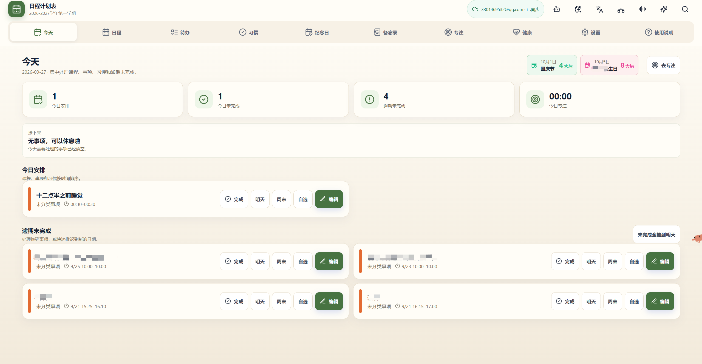

今天页集中显示当天安排和逾期事项，可直接完成任务，或推迟到明天、周末及指定日期。

### 课程与事项共用一张周课表

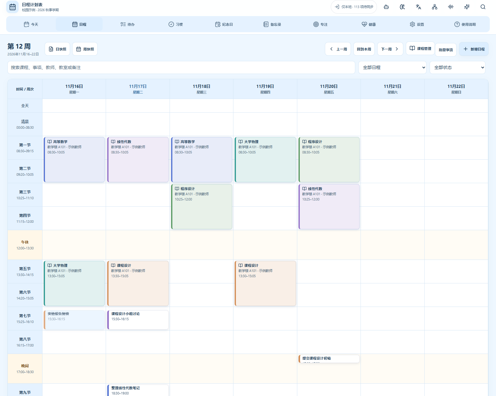

课程按教学周和节次排入课表，临时事项按实际起止时间显示在同一时间轴上；图中为校园示例数据。

天津大学导出的 HTML-XLS 课表可以预览后导入，节次和休息时段可按星期分别设置。普通事项不依赖学期，也可设置每天、工作日、每周、每月或自定义间隔重复。

### 每次打卡分别记录

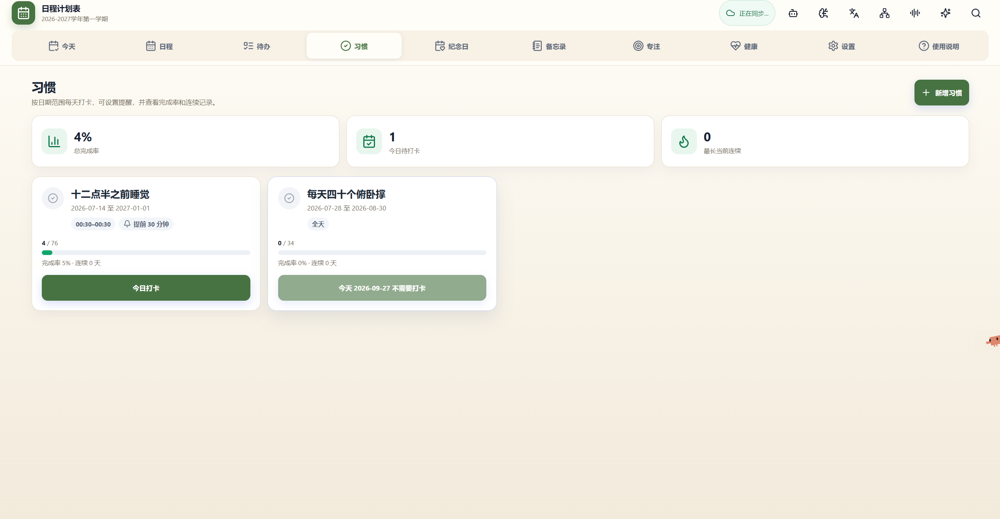

习惯按日期范围逐日打卡，显示完成率和连续记录，完成某一天不会结束整个重复计划。

### 专注时长可以关联任务

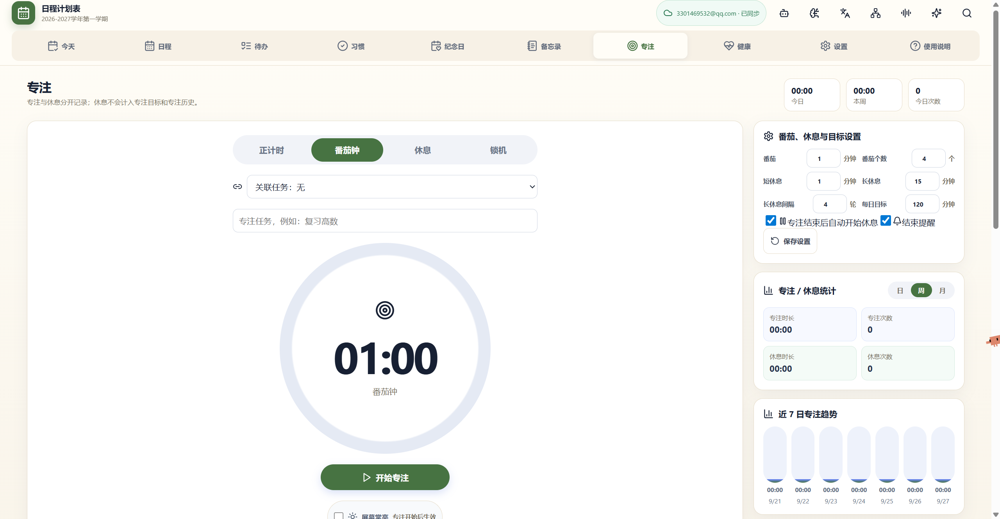

专注支持正计时、倒计时和番茄钟，可关联日程事项；专注与休息分别记录，并提供按日、周、月查看的统计。

## 手机端：随手查看和记录

手机端保留日程与学习工具，采用底部导航和浮动新增按钮；表单随屏幕尺寸调整，便于单手操作。

<table>
<tr>
<td align="center" valign="top" width="50%">
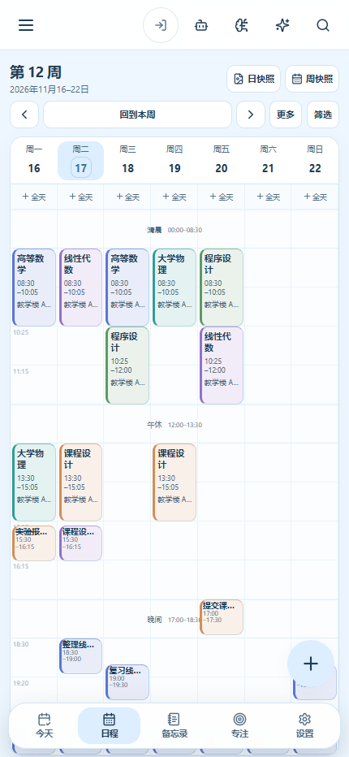
<p>七日周课表在一屏内呈现课程与事项的时间分布。</p>
</td>
<td align="center" valign="top" width="50%">
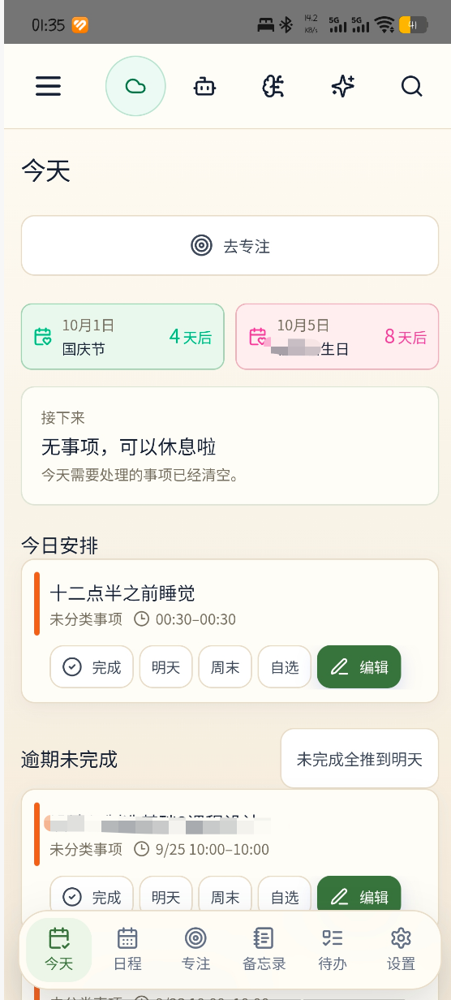
<p>当天事项可以直接标记完成或调整日期。</p>
</td>
</tr>
<tr>
<td align="center" valign="top">
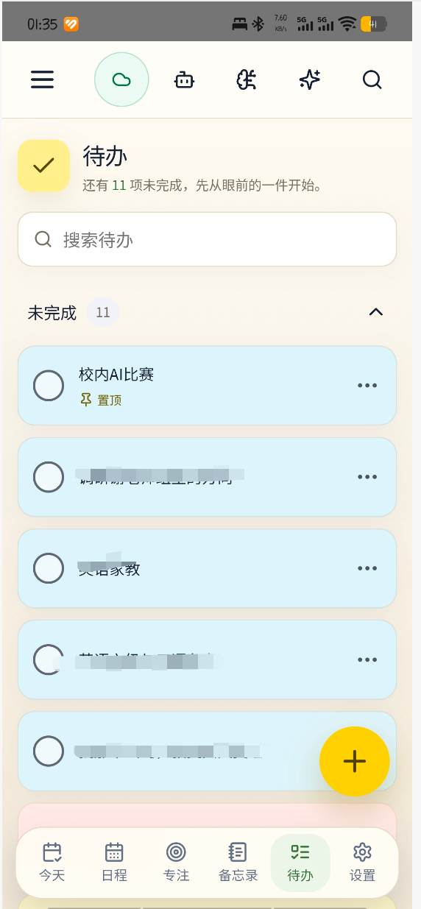
<p>独立待办支持搜索、置顶和完成状态管理。</p>
</td>
<td align="center" valign="top">
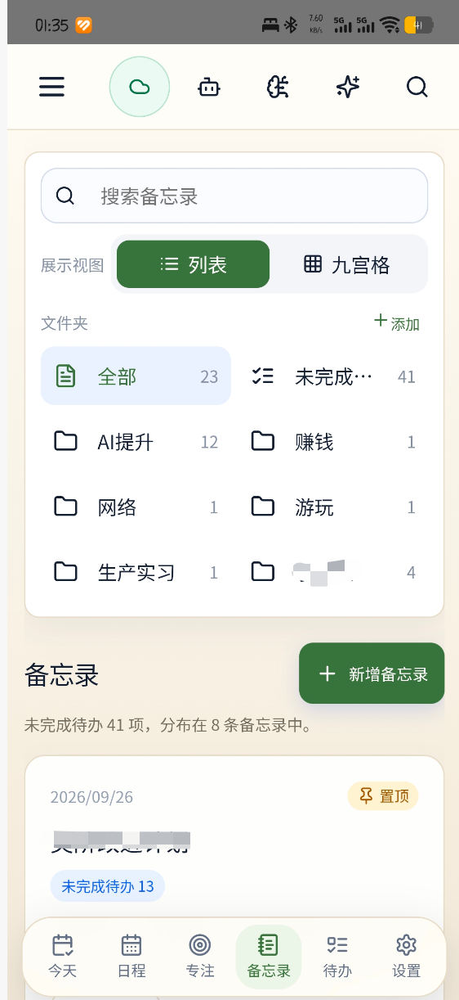
<p>备忘录按文件夹整理，支持搜索、置顶和清单。</p>
</td>
</tr>
<tr>
<td align="center" valign="top">
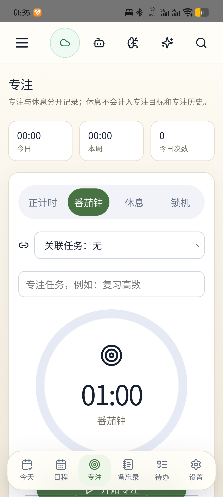
<p>手机上可以选择关联任务并开始专注计时。</p>
</td>
<td align="center" valign="top">
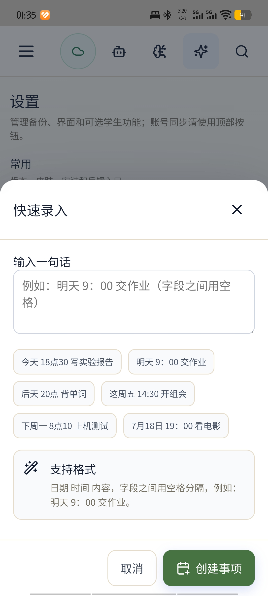
<p>快速录入按“日期、时间、内容”解析一句话事项。</p>
</td>
</tr>
</table>

纪念日支持公历、农历及单独提醒；健康页可记录饮水、活动和体重。用户也可以调整主题、字号以及顶部和底部工具的排列。

## AI 日程操作与资料整理

### 从一句指令到日程记录

AI 助手结合当前账号的日程摘要理解请求，支持创建事项、习惯、纪念日和备忘录，也能修改或删除事项。例如输入“明天 19:00 到 19:30 复习线性代数，提前 10 分钟提醒我”，可生成带时间和提醒设置的事项，随后继续用自然语言调整时间。

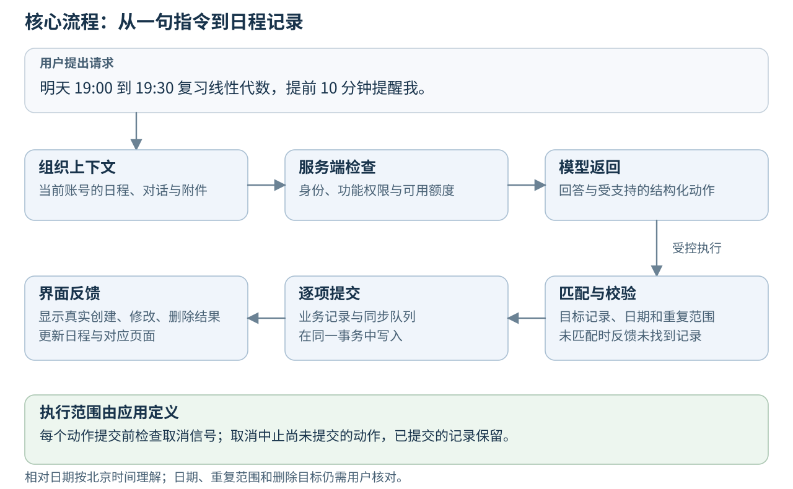

模型返回的动作由应用匹配记录并执行，界面反馈实际创建、修改或删除的结果；日期、重复范围和删除目标仍需用户核对。

另设本地日程助手，直接按规则查询课程、教室、未完成事项、冲突和统计，不调用外部模型。快速录入也在本机解析，云端 AI 则用于更自由的表达和资料理解。

### 文档整理为思维导图

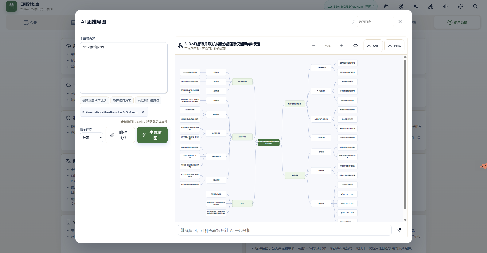

上传文档或输入主题后生成树形脑图，可缩放、继续追问，并导出 SVG 或 PNG。

支持附件的模型可处理图片及 PDF、DOCX、TXT、Markdown、CSV。PDF 优先提取文字，扫描件按页面处理，长内容分批整理，避免整份资料一次塞入请求。

### 录音转写与摘要

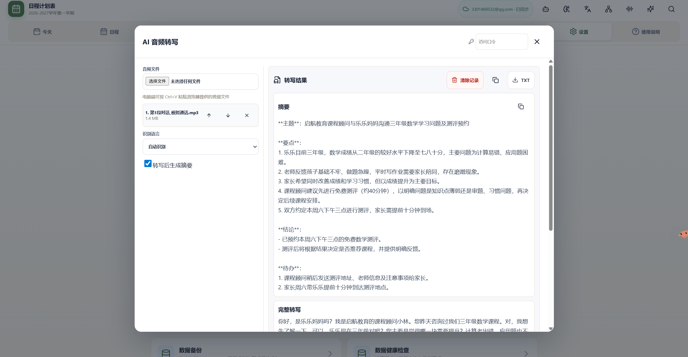

音频工具同时提供完整转写和摘要，支持复制结果及导出 TXT，便于整理课堂录音或讨论记录。

长音频分段处理并保存处理中间结果。AI 助手、思维导图和音频转写分别控制权限与额度，具体格式、文件大小和数量受界面及服务端配置限制。

## 系统设计

### 本地先保存，云端按需使用

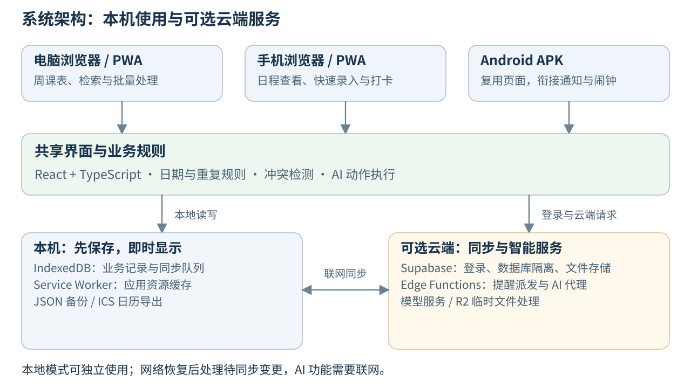

网页、PWA 和 Android APK 共用界面与业务规则。课程、事项和记录先写入本机数据库，页面直接读取本机数据；登录、同步、云端推送和 AI 服务在需要时接入。

| 层次 | 技术与作用 |
| --- | --- |
| 界面与规则 | React、TypeScript、Vite，组织页面并处理日期、重复和冲突规则 |
| 本机数据 | Dexie / IndexedDB，持久保存业务记录和同步队列 |
| 云端服务 | Supabase Auth、PostgreSQL / RLS、Storage、Edge Functions，处理身份、数据隔离、同步、提醒和 AI 请求 |
| 多端支持 | Service Worker 缓存应用资源；Capacitor 衔接 Android 原生能力 |

### 让记录彼此关联

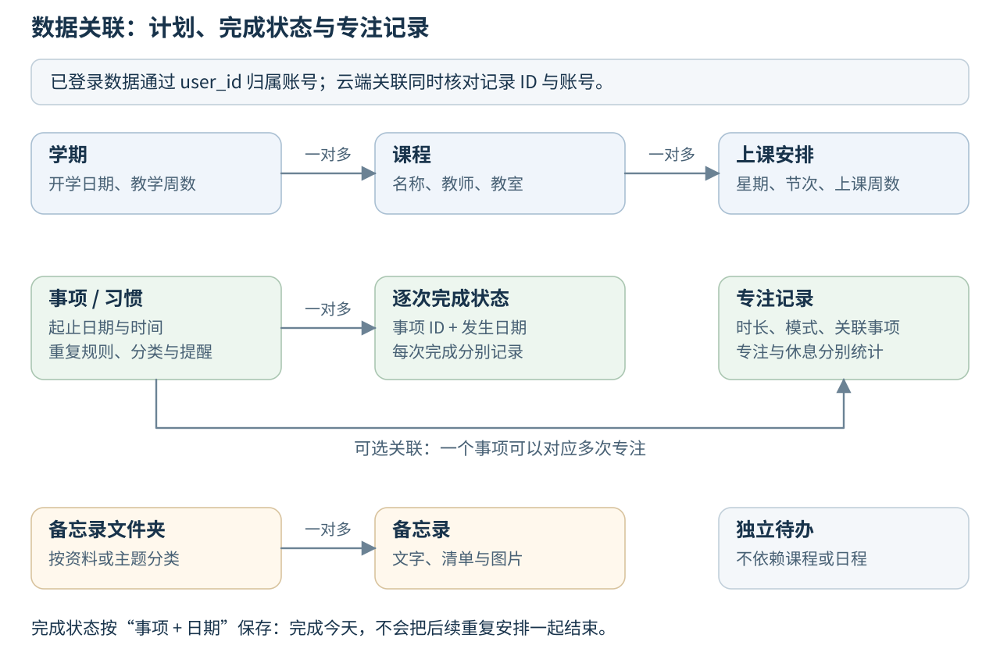

学期管理课程，课程拥有多个上课安排；事项和习惯共用重复规则，每次发生的完成状态单独保存。专注记录可关联某个事项，备忘录归入文件夹，独立待办则不要求先创建课程或日程。

### 账号、权限与同步

| 设计 | 解决的问题 |
| --- | --- |
| 数据归属账号 | 本机查询按当前账号过滤，云端 RLS 校验登录身份与记录所属账号，切换账号时不混用私人记录 |
| 关联也检查归属 | 云端课程、事项、完成状态等关联同时核对记录 ID 和账号，防止把不同账号的数据连在一起 |
| 变更与队列一起提交 | 业务记录和待同步操作在同一事务中保存，避免只改了界面数据却漏掉上传任务 |
| 先上传，再拉取变化 | 同步比较记录 ID、版本和修改信息，保护尚未上传的本机编辑；失败项保留原因，便于重试 |
| 高权限留在服务端 | AI 凭据不进入前端；普通用户、会员和管理员的权限与额度由服务端检查，模型只返回应用支持的动作 |

应用在启动、恢复前台、网络恢复和本机待上传数量变化时尝试同步，也可手动同步。多设备编辑采用版本与修改信息合并，尚不提供多人实时协作或字段级冲突合并。JSON 用于备份与恢复，ICS 用于导出到系统日历。

## 使用方式

本地运行需要 Node.js 22 LTS 或更新版本。在项目根目录执行：

```powershell
npm ci
npm run dev
```

浏览器打开终端显示的本地地址即可使用，Windows 也可双击根目录的“启动日程.cmd”。基础日程、待办、备忘录和专注无需登录；课程表在创建学期后使用。需要账号同步或云端 AI 时，再配置 Supabase 和相应的服务端凭据。

浏览器支持时可安装为 PWA，Android 另有 Capacitor APK。离线使用依赖已缓存的应用资源和本机数据；AI 需要联网，通知、精确闹钟和画中画受设备能力及系统权限影响。

技术配置与维护见 [设计文档](DESIGN.md)、[Supabase 配置](docs/SUPABASE_SETUP.md)、[提醒机制](docs/REMINDERS.md)和 [Android 更新渠道](docs/ANDROID_UPDATE_CHANNEL.md)。
